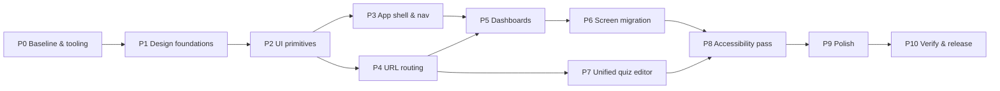

# UI / UX Overhaul Plan

> **For agentic workers:** Execute phase by phase, in order. Each phase must leave the app shippable. Steps use checkbox (`- [ ]`) syntax for tracking. Do not start a phase until the previous phase's **Exit criteria** are met.

**Goal:** Raise the app from ≈5.5/10 to ≥8/10 on visual design, modern style and ease of use. Do this without breaking the live-quiz realtime flows (sessions, reconnection, team mode, defuse mode).

**Baseline audit (2026-11-17, from code review):**

| Area | Score | Primary causes |
|---|---|---|
| Visual design | 5.5 | No design tokens (empty `tailwind.config.js`); 26 hard-coded hex colors in 125 inline `style={{}}` blocks; each screen uses a different palette |
| Modern style | 5 | Heavy gradients, `shadow-2xl`, `hover:scale-105` everywhere; emoji mixed with Lucide icons; default Vite favicon |
| Ease of use | 6 | No URL routing (Back leaves the app, no deep links); empty teacher dashboard; "Join with PIN" hidden behind a card; weak accessibility (10 `aria-*` attributes app-wide, ~15 clickable `<div>`s) |

**Architecture:** Clean layering for all new code.
- **Domain:** zod schemas and pure functions in `src/schemas/` and `src/domain/`.
- **Application:** hooks in `src/hooks/` that orchestrate use cases.
- **Infrastructure:** Supabase repositories in `src/infrastructure/`.
- **Presentation:** `src/components/ui/` (primitives), `src/components/layout/`, feature components and route modules in `src/routes/`.

**Tech stack:**
- Existing: React 18, Vite 7, Tailwind 3, Supabase JS, i18next, zod 4, Vitest, Lucide.
- New: React Router 7 (data router), `clsx` + `tailwind-merge`, `@fontsource-variable/inter`, `@fontsource/noto-sans-jp`, `react-qr-code`, `eslint` + `eslint-plugin-jsx-a11y`, `vitest-axe`.

**Language policy:** New files are written in **TypeScript with `strict: true`** (Vite supports mixed JS/TS through `allowJs`). Existing `.jsx` files are converted only when a phase already rewrites them. Supabase types come from `supabase gen types typescript` and are committed to `src/infrastructure/database.types.ts`.

---

## Phase Overview



| Phase | Effort (dev-days) | Risk |
|---|---|---|
| P0 Baseline & tooling | 1 | Low |
| P1 Design foundations | 2 | Low |
| P2 UI primitives | 3 | Low |
| P3 App shell & navigation | 2 | Medium |
| P4 URL routing | 4 | **High** (touches every screen + session persistence) |
| P5 Dashboards redesign | 4 | Medium |
| P6 Screen-by-screen migration | 6–8 | Medium |
| P7 Unified quiz editor | 5–7 | **High** (largest files: `CreateQuiz.jsx` 57 KB, `EditQuiz.jsx` 64 KB) |
| P8 Accessibility pass | 2–3 | Low |
| P9 Polish | 3–4 | Low |
| P10 Verify & release | 1–2 | Low |
| **Total** | **≈33–40** | |

---

## Open Decisions (resolve before P1)

| # | Decision | Recommendation |
|---|---|---|
| D1 | Brand primary color | **Teal** (`#4a7c7e` family, already used in sidebar + login). Use `brand-600` (`#3d6668`) for buttons with white text: contrast 6.4:1 (AA). `brand-500` with white text is only 4.7:1. |
| D2 | Accent color | **Blue `#2c5aa0`** (already the heading color). Use it only for links and focus rings. Drop the blue→cyan gradient. |
| D3 | Router | **React Router 7** data router (`createBrowserRouter`): it provides `useBlocker` for unsaved-changes guards and lazy routes. |
| D4 | Dialog implementation | **Native `<dialog>` + `showModal()`**: no dependency, built-in focus containment, top layer, Escape handling. Add Radix primitives only if dropdown menus/popovers become complex. |
| D5 | Dark mode | **Defer.** Classroom projectors favor light UI. Tokens use CSS variables, so adding dark mode later stays cheap. |
| D6 | Live-quiz screens | **Keep vibrant.** The new restrained palette applies to admin/teacher/student chrome only. Live play keeps the four answer colors + themes. |

---

## Phase 0 — Baseline & Tooling

**Purpose:** Create a reference to measure against, plus guardrails that prevent regressions.

- [ ] **0.1** Capture baseline screenshots at 375 px, 768 px and 1440 px for these screens: login, register, student dashboard, join PIN, live question (student), teacher dashboard, manage quizzes, create quiz, waiting lobby, teacher live question, question results, leaderboard, reports, settings. Save to `docs/ui-baseline/2026-11-17/`.
- [ ] **0.2** Run Lighthouse (mobile) on login + both dashboards. Record Performance / Accessibility / Best Practices scores in `docs/ui-baseline/2026-11-17/lighthouse.md`.
- [x] **0.3** Add ESLint (flat config) with `eslint-plugin-react`, `eslint-plugin-react-hooks`, `eslint-plugin-jsx-a11y`. Start with a11y rules set to `warn` and record the warning count as the baseline.
- [x] **0.4** Add a token-guard script `scripts/check-tokens.mjs`. It fails if a new hex color literal appears in `src/**/*.{jsx,tsx}` outside `src/theme/` and `src/components/quizzes/ThemeSelector.jsx` (theme data is legitimately hex). Add it to `npm run lint`.
- [x] **0.5** Add `typescript`, a `tsconfig.json` (`strict: true`, `allowJs: true`, `checkJs: false`, `jsx: "react-jsx"`, `moduleResolution: "bundler"`) and `npm run typecheck`.
- [x] **0.6** Generate Supabase types: `supabase gen types typescript --project-id <id> > src/infrastructure/database.types.ts`.

**Exit criteria:** Baseline artifacts committed; `npm run lint`, `npm run typecheck` and `npm test` all run in CI (warnings allowed, no errors).

---

## Phase 1 — Design Foundations

**Purpose:** One source of truth for color, type, radius, shadow and motion.

### 1.1 Tokens

- [ ] Create `src/theme/tokens.css` with semantic CSS variables (RGB channels so Tailwind alpha modifiers work):

```css
:root {
  /* Brand (teal) */
  --brand-50: 240 247 247;  --brand-100: 217 235 235; --brand-200: 181 215 216;
  --brand-300: 134 187 189; --brand-400: 95 155 157;  --brand-500: 74 124 126;
  --brand-600: 61 102 104;  --brand-700: 51 84 86;    --brand-800: 43 69 71;
  --brand-900: 36 58 59;
  /* Accent */
  --accent-500: 44 90 160;
  /* Surfaces & text */
  --surface: 255 255 255;   --surface-muted: 246 248 249; --canvas: 241 244 245;
  --line: 226 231 233;      --ink: 31 58 82;              --ink-muted: 82 100 115;
  /* Feedback */
  --success-600: 5 150 105; --warning-500: 245 158 11; --danger-600: 220 38 38;
  /* Live-quiz answer colors (kept vibrant) */
  --answer-1: 239 68 68; --answer-2: 37 99 235; --answer-3: 249 115 22; --answer-4: 34 197 94;
}
```

- [ ] Replace `tailwind.config.js`:

```js
/** @type {import('tailwindcss').Config} */
const rgb = (v) => `rgb(var(${v}) / <alpha-value>)`;
const scale = (name, steps) =>
  Object.fromEntries(steps.map((s) => [s, rgb(`--${name}-${s}`)]));

export default {
  content: ["./index.html", "./src/**/*.{js,ts,jsx,tsx}"],
  theme: {
    extend: {
      colors: {
        brand: scale("brand", [50, 100, 200, 300, 400, 500, 600, 700, 800, 900]),
        accent: { 500: rgb("--accent-500") },
        surface: { DEFAULT: rgb("--surface"), muted: rgb("--surface-muted") },
        canvas: rgb("--canvas"),
        line: rgb("--line"),
        ink: { DEFAULT: rgb("--ink"), muted: rgb("--ink-muted") },
        success: { 600: rgb("--success-600") },
        warning: { 500: rgb("--warning-500") },
        danger: { 600: rgb("--danger-600") },
        answer: { 1: rgb("--answer-1"), 2: rgb("--answer-2"), 3: rgb("--answer-3"), 4: rgb("--answer-4") },
      },
      fontFamily: {
        sans: ['"Inter Variable"', '"Noto Sans JP"', "system-ui", "sans-serif"],
      },
      borderRadius: { xl: "0.875rem", "2xl": "1.25rem" },
      boxShadow: {
        card: "0 1px 2px rgb(16 24 40 / 0.06), 0 1px 3px rgb(16 24 40 / 0.08)",
        pop: "0 12px 32px -8px rgb(16 24 40 / 0.18)",
      },
    },
  },
  plugins: [],
};
```

- [ ] Import `tokens.css` at the top of `src/index.css`.

### 1.2 Typography

- [ ] Install `@fontsource-variable/inter` and `@fontsource/noto-sans-jp` (weights 400/500/700 only) and import them in `main.jsx`.
- [ ] Define the type scale in `src/index.css` `@layer base`: `h1` = `text-2xl md:text-3xl font-bold tracking-tight text-ink`, `h2` = `text-xl font-semibold`, body `text-[15px] leading-relaxed`. Add `:lang(ja) { line-height: 1.8; }`.

### 1.3 Brand assets & document metadata

- [ ] Move the logo from `https://pierenglishschool.com/quizapp/images/logo.png` to `public/brand/logo.svg` (or an optimized `.webp`) so a third-party domain outage can't break the sidebar.
- [ ] Replace `/vite.svg` with a real favicon set + `site.webmanifest` + `<meta name="theme-color" content="#3d6668">`.
- [ ] Rename `<title>` from "QuizMaster App" to the final product name and add `<meta name="description">`.
- [ ] Sync `<html lang>` with i18next: `i18n.on("languageChanged", (lng) => { document.documentElement.lang = lng; });` in `src/i18n.js`.
- [ ] Compress `spring_theme.png` (1.7 MB, duplicated in `public/` and `src/images/`) to WebP ≤ 250 KB and delete the duplicate.

### 1.4 Motion

- [ ] Add a global reduced-motion rule to `src/index.css`:

```css
@media (prefers-reduced-motion: reduce) {
  *, *::before, *::after {
    animation-duration: 0.01ms !important;
    animation-iteration-count: 1 !important;
    transition-duration: 0.01ms !important;
    scroll-behavior: auto !important;
  }
}
```

- [ ] Standard durations: 150 ms (hover/press), 200 ms (modals/toasts), 300 ms (drawers). Remove `hover:scale-105` from non-game UI.

**Exit criteria:** Tokens and fonts load; no visual change required yet; `check-tokens` passes on new files.

---

## Phase 2 — UI Primitives (`src/components/ui/`)

**Purpose:** Every screen builds from the same few accessible components. This removes the inline `style={{}}` and the `onMouseEnter`/`onFocus` style mutation hacks (e.g. [Login.jsx](../../../src/components/auth/Login.jsx) lines 242–245, 303–304; [VerticalNav.jsx](../../../src/components/layout/VerticalNav.jsx) lines 184–185).

| Component | Requirements |
|---|---|
| `cn.ts` | `clsx` + `tailwind-merge` helper |
| `Button.tsx` | Variants `primary / secondary / ghost / danger`; sizes `sm / md / lg`; `loading` state with spinner + `aria-busy`; default `type="button"`; visible `focus-visible` ring |
| `IconButton.tsx` | Requires an `aria-label` prop (typed as required) |
| `Card.tsx` | `Card`, `CardHeader`, `CardBody`, `CardFooter`; `interactive` variant renders as `<button>` or `<a>`, never a clickable `<div>` |
| `Input.tsx`, `Textarea.tsx`, `Select.tsx` | Use `focus-visible:ring`, not JS border swaps |
| `Field.tsx` | Label + control + hint + error; wires `id`, `htmlFor`, `aria-describedby`, `aria-invalid` automatically; shows zod issue messages |
| `Dialog.tsx` | Native `<dialog>` + `showModal()`; `aria-labelledby` / `aria-describedby`; Escape closes unless `busy`; backdrop click closes; returns focus to the trigger. Replaces the internals of `ConfirmModal` and `AlertModal` (keep their public props so call sites don't change). |
| `Toast.tsx` + `ToastProvider` | `useToast()` with `success / error / info`; `role="status"` (polite) or `role="alert"` (errors); auto-dismiss 5 s; pause on hover |
| `Badge.tsx` | Neutral / brand / success / warning / danger |
| `PageHeader.tsx` | Title, optional description, breadcrumbs slot, actions slot. Replaces the duplicated top-bar `<h1>` + body `<h2>` pattern. |
| `EmptyState.tsx` | Icon, title, description, primary + secondary action |
| `Skeleton.tsx`, `Spinner.tsx` | Consolidate the 26 ad-hoc `animate-pulse` and 17 `animate-spin` usages |
| `Icon.tsx` | Central map of semantic names to Lucide icons (`cancelled`, `survey`, `bomb`, `celebrate`, `waiting`). Replaces the ~51 emoji usages in UI chrome. Emoji may stay inside celebratory game moments by design decision only. |

Reference implementation for the pattern all primitives follow:

```tsx
// src/components/ui/Button.tsx
import { forwardRef, type ButtonHTMLAttributes } from "react";
import { Loader2 } from "lucide-react";
import { cn } from "./cn";

type Variant = "primary" | "secondary" | "ghost" | "danger";
type Size = "sm" | "md" | "lg";

const VARIANTS: Record<Variant, string> = {
  primary: "bg-brand-600 text-white hover:bg-brand-700",
  secondary: "bg-surface text-ink border border-line hover:bg-surface-muted",
  ghost: "text-ink-muted hover:bg-surface-muted hover:text-ink",
  danger: "bg-danger-600 text-white hover:brightness-95",
};

const SIZES: Record<Size, string> = {
  sm: "h-8 px-3 text-sm",
  md: "h-10 px-4 text-sm",
  lg: "h-12 px-6 text-base",
};

export interface ButtonProps extends ButtonHTMLAttributes<HTMLButtonElement> {
  variant?: Variant;
  size?: Size;
  loading?: boolean;
}

export const Button = forwardRef<HTMLButtonElement, ButtonProps>(function Button(
  { variant = "primary", size = "md", loading = false, disabled, className, children, type = "button", ...rest },
  ref,
) {
  return (
    <button
      ref={ref}
      type={type}
      disabled={disabled || loading}
      aria-busy={loading || undefined}
      className={cn(
        "inline-flex items-center justify-center gap-2 rounded-lg font-medium transition-colors duration-150",
        "focus-visible:outline-none focus-visible:ring-2 focus-visible:ring-accent-500 focus-visible:ring-offset-2",
        "disabled:cursor-not-allowed disabled:opacity-50",
        VARIANTS[variant],
        SIZES[size],
        className,
      )}
      {...rest}
    >
      {loading && <Loader2 className="h-4 w-4 animate-spin" aria-hidden="true" />}
      {children}
    </button>
  );
});
```

- [x] **2.1** Implement primitives above with unit tests (render, keyboard activation, disabled/loading, a11y via `vitest-axe`).
- [x] **2.2** Create `src/routes/dev/UiGallery.tsx` (dev-only route, excluded from production via `import.meta.env.DEV`) that shows every primitive in every state. Use it for visual review.
- [x] **2.3** Upgrade `lucide-react` from `0.263.1` to current. Fix any renamed icon imports (run `npm run build` to surface them).

**Exit criteria:** All primitives tested and visible in the gallery; `ConfirmModal`/`AlertModal` use `Dialog` internally with no call-site changes; build green.

---

## Phase 3 — App Shell & Navigation

**Purpose:** One consistent frame on desktop and mobile.

- [x] **3.1** Create `src/components/layout/AppShell.tsx`: sidebar (desktop) / top bar + drawer (mobile), `<main id="main">` landmark, and a "Skip to content" link. Every authenticated screen renders inside it. Remove the per-screen `<VerticalNav>` + `md:ml-64 pt-16 md:pt-0` boilerplate.
- [ ] **3.2** Rebuild `VerticalNav` on tokens:
  - Desktop and mobile share **one** nav item renderer and **one** palette (today: teal desktop vs. white/blue-cyan mobile).
  - Active item: `bg-white/15` + left indicator bar + `aria-current="page"`.
  - Remove the `onMouseEnter` style mutation on Logout; use `hover:bg-danger-600/20`.
  - Mobile drawer: render as a `Dialog`-style drawer (focus contained, Escape closes, `aria-expanded` on the hamburger, `aria-label` on the toggle).
  - Collapse user info + language switcher into a compact account menu at the bottom of the sidebar.
- [ ] **3.3** Restructure teacher navigation (today it has 7 flat items, and Public and Global share the `Globe` icon):

  | Group | Items | Icon |
  |---|---|---|
  | — | **+ New quiz** (primary button at top of nav) | `Plus` |
  | — | Dashboard | `LayoutDashboard` |
  | Library | My quizzes | `FolderOpen` |
  | Library | School library (was "Public") | `Building2` |
  | Library | Community library (was "Global") | `Globe` |
  | Class | Students | `Users` |
  | Class | Reports | `BarChart3` |

  Confirm final labels for "School" vs. "Community" against what Public/Global actually mean, and update `en.json` + `ja.json`.
- [ ] **3.4** Student navigation: Dashboard, Assignments (with pending-count badge), Results. Today the nav has only "Dashboard" and the rest is hidden in cards.

**Exit criteria:** Every authenticated screen renders inside `AppShell`; desktop/mobile nav look like the same product; keyboard can open/close the drawer and reach every item.

---

## Phase 4 — URL Routing

**Purpose:** Make the browser Back button work, allow deep links and refresh-safe screens, and enable `/join/:pin` links and QR codes. Today the active view lives in `sessionStorage['quizapp_view']` ([App.jsx](../../../src/App.jsx) line 70), and all 26 screens are imported eagerly.

### 4.1 Route map

| Legacy `view` | Path | Guard |
|---|---|---|
| `login` | `/login` | guest |
| `register` | `/register` (accepts `?teacher=CODE`) | guest |
| `registration-success` | `/register/success` | guest |
| `verify` | `/verify` | guest |
| `forgot-password` | `/forgot-password` | guest |
| `reset-password` | `/reset-password` | any |
| `complete-profile` | `/complete-profile` | auth, no role |
| `student-dashboard` | `/student` | student |
| — (new) | `/join/:pin?` | student (redirect to login with `?next=`) |
| `student-quiz` | `/play/:sessionId` | student |
| `assigned-quizzes` | `/student/assignments` | student |
| `assigned-quiz-taking` | `/student/assignments/:assignmentId` | student |
| (results sub-view) | `/student/results` | student |
| (create-team sub-view) | `/student/team` | student |
| `teacher-dashboard` | `/teacher` | teacher |
| `manage-quizzes` | `/teacher/quizzes` (folder in `?folder=`) | teacher |
| `create-quiz` | `/teacher/quizzes/new` | teacher |
| `edit-quiz` | `/teacher/quizzes/:quizId/edit` | teacher |
| `preview-quiz` | `/teacher/quizzes/:quizId/preview` | teacher |
| `teacher-control` | `/teacher/host/:sessionId` | teacher |
| `manage-students` | `/teacher/students` | teacher |
| `reports` | `/teacher/reports` | teacher |
| `student-report` | `/teacher/reports/students/:studentId` | teacher |
| `public-quizzes` | `/teacher/library/school` | teacher |
| `global-quizzes` | `/teacher/library/community` | teacher |
| `superadmin-dashboard` | `/admin` | superadmin |
| `settings` | `/settings` | auth |
| — | `*` → friendly 404 with "Go to dashboard" | — |

### 4.2 Steps

- [x] **4.2.1** Install `react-router` v7. Create `src/routes/router.tsx` with `createBrowserRouter`. Every route module uses `lazy()` for code-splitting.
- [x] **4.2.2** Create `src/routes/guards.tsx`: `RequireGuest`, `RequireRole({ roles })`. These hold the role/approved/verified checks currently duplicated in `Login.jsx` (`checkSession` and `handleLogin`) and `App.jsx`. Move that logic into a single domain function `resolveLandingPath(profile)` in `src/domain/auth.ts`, with unit tests.
- [x] **4.2.3** **Migration shim:** so screens can move one at a time, add `useLegacySetView()`. It maps old `setView(view, id)` calls to `navigate()`:

```ts
// src/routes/legacyNavigation.ts
import { useCallback } from "react";
import { useNavigate } from "react-router";

const VIEW_TO_PATH: Record<string, (id?: string) => string> = {
  "student-dashboard": () => "/student",
  "student-quiz": (id) => `/play/${id}`,
  "teacher-dashboard": () => "/teacher",
  "manage-quizzes": () => "/teacher/quizzes",
  "create-quiz": () => "/teacher/quizzes/new",
  "edit-quiz": (id) => `/teacher/quizzes/${id}/edit`,
  "preview-quiz": (id) => `/teacher/quizzes/${id}/preview`,
  "teacher-control": (id) => `/teacher/host/${id}`,
  // ...one entry per row in the route map
};

export function useLegacySetView() {
  const navigate = useNavigate();
  return useCallback(
    (view: string, id?: string) => {
      const toPath = VIEW_TO_PATH[view];
      if (!toPath) throw new Error(`Unmapped legacy view: ${view}`);
      navigate(toPath(id));
    },
    [navigate],
  );
}
```

- [x] **4.2.4** Replace `selectedQuizId` / `selectedSessionId` app state + sessionStorage with route params (`useParams`). Remove `quizapp_view`, `quizapp_selectedQuizId` and `quizapp_selectedSessionId`. Simplify the logout key-clearing in `VerticalNav.handleLogout` to match.
- [x] **4.2.5** **Preserve live-session resilience:** `sessionPersistence.js` and the rejoin banner must keep working. `/play/:sessionId` and `/teacher/host/:sessionId` now survive refresh natively. Re-run `src/test/sessionReconnection.test.js` and `appSession.test.jsx` and extend them for route params.
- [x] **4.2.6** Support OAuth/email redirects: Supabase `redirectTo` returns to `/` and the root loader routes by role via `resolveLandingPath`. The password-reset link must land on `/reset-password`.
- [x] **4.2.7** Confirm `public/_redirects` has the SPA fallback (`/* /index.html 200`) and that `netlify.toml` has no conflicting rule.
- [ ] **4.2.8** Remove the shim once no `setView` calls remain (`grep -r "setView" src` returns nothing).

**Exit criteria:** Back/forward works on every screen; refreshing any screen keeps you there; deep links work after login (`?next=`); all session tests pass; the initial JS bundle is smaller (record before/after from `vite build`).

---

## Phase 5 — Dashboards Redesign

### 5.1 Data layer (Clean Architecture)

- [x] `src/schemas/dashboard.ts`: zod schemas `TeacherDashboardSummary` and `StudentDashboardSummary`. Parse every Supabase response; on parse failure, show an error state, never `undefined` crashes.
- [x] `src/infrastructure/dashboardRepository.ts`: typed queries using `database.types.ts`. Run them in parallel with `Promise.all`. Reuse the existing query logic in `useReports.js` / `useManageStudents.js` (don't write it a second time).
- [x] `src/hooks/useTeacherDashboard.ts`, `useStudentDashboard.ts`: loading / error / data states, refetch on window focus.
- [ ] **No new tables are expected.** If an aggregate RPC is needed for performance, create it as `SECURITY INVOKER` so existing RLS applies. Any new table **must** ship with `ALTER TABLE … ENABLE ROW LEVEL SECURITY;` and explicit policies in the same migration.

### 5.2 Teacher dashboard

Replace the current three link cards, which duplicate the sidebar, and the doubled title.

```text
┌ PageHeader: "Good evening, {name}"            [+ New quiz] [▶ Host a quiz] ┐
├──────────────────────────────────────────────────────────────────────────────┤
│ [Live now: 1 session · 23 players → Resume]   (only when a session is live) │
├───────────────┬───────────────┬───────────────┬──────────────────────────────┤
│ Quizzes  42   │ Students 118  │ Pending ✋ 3   │ Avg score (7 days) 76%       │
├───────────────┴───────────────┴───────────────┴──────────────────────────────┤
│ Recent quizzes (5) — title · last played · [Host] [Edit]                    │
│ Assignments due this week — quiz · class · completion bar                   │
├──────────────────────────────────────────────────────────────────────────────┤
│ Invite students: code ABCD-1234 [Copy] [Copy invite link] [Show QR]         │
└──────────────────────────────────────────────────────────────────────────────┘
```

- [x] Stat cards link to the filtered destination (e.g. "Pending 3" → `/teacher/students?filter=pending`).
- [x] "Host a quiz" opens a quiz picker dialog → existing `ModeSelection` flow.
- [x] Invite card: copy code, copy link `/register?teacher=CODE`, QR (`react-qr-code`). Move it below the fold once the teacher has ≥ 1 approved student.
- [x] Remove the `console.log` calls in `copyTeacherCode`; give copy feedback with a toast plus the icon swap.
- [x] First-run state (0 quizzes): `EmptyState` with "Create your first quiz", "Import from CSV" and "Browse the library".

### 5.3 Student dashboard

Replace the four equal cards with a task-first layout.

```text
┌──────────────────────────────────────────────┐
│  Hi {name} 👋                                 │
│  ┌────────────────────────────┐  [ Join ]    │  ← large PIN input, numeric keypad
│  │  Enter game PIN            │              │     (inputmode="numeric", autofocus)
│  └────────────────────────────┘              │
│  or  [Join as a team]                        │
├──────────────────────────────────────────────┤
│ ⟳ Rejoin "Prepositions" — 1,200 pts [Rejoin] │  ← existing rejoin banner, restyled
├──────────────────────────────────────────────┤
│ Assignments (2 due)   · Quiz · due Fri [Start]│
│ Recent results        · Quiz · 8/10 · 3rd     │
└──────────────────────────────────────────────┘
```

- [x] The PIN form submits directly, using the existing `JoinClassicQuiz` validation logic extracted into a hook. Validate with zod (digits only, exact length).
- [x] `/join/:pin` pre-fills the PIN and auto-submits after login.
- [x] **Unapproved students:** replace the four disabled, greyed cards with one clear status card: "Waiting for {teacher} to approve you", what happens next, and a "Check again" button.
- [x] Rejoin banner: use `IconButton` with `aria-label` for dismiss (today it is a bare "✕").
- [x] Remove the full-screen blue gradient. Use the `canvas` background with a single brand-tinted hero band.

**Exit criteria:** Teacher sees real data on load with skeletons; student joins a quiz in one step from the dashboard; both pass axe with zero violations.

---

## Phase 6 — Screen-by-Screen Migration

Each screen: move to the AppShell route, replace inline styles/hex colors with tokens and primitives, use `PageHeader`, add empty/error/loading states, translate any hard-coded strings.

| # | Screen(s) | Notable work |
|---|---|---|
| 6.1 | Login, Register, ForgotPassword, ResetPassword, VerifyEmail, RegistrationSuccess, CompleteProfile | Shared `AuthLayout` (split layout: brand panel left, form right; stacked on mobile). Password show/hide toggle. Inline field errors via `Field` (today it is one error banner). Unify "verify email" messages through i18n (hard-coded English in `Login.jsx`). |
| 6.2 | Manage Quizzes (+ FolderTree, QuizCard, QuizToolbar, modals) | Grid/list toggle; consistent card actions in an overflow menu; `?folder=` and `?q=` in URL; empty folder state. |
| 6.3 | Manage Students (+ table, modals) | Pending approvals pinned at top with bulk approve; sticky table header; mobile card layout below `md`. |
| 6.4 | Reports, StudentReport, QuestionAnalysis, StatsCards, PerformanceTable | Consistent stat cards; accessible tables (`<th scope>`); date-range filter in URL. |
| 6.5 | Public / Global quiz libraries | Search + filters in URL; preview drawer instead of full navigation. |
| 6.6 | Settings, AvatarThumbnail | Sectioned settings (Profile, Account, Language, Notifications); save toasts. |
| 6.7 | Assigned quizzes, AssignedQuizTaking | Due-date badges (overdue / due soon); progress indicator. |
| 6.8 | Teacher live control: ModeSelection, WaitingLobby, ActiveQuestion, QuestionResults, Leaderboard, QuizCompleted, CountdownScreen | Keep vibrant (D6). **WaitingLobby:** huge PIN + `/join/:pin` QR code for projector. Answer colors from `answer-1..4` tokens. Fix the hard-coded `answer/answers` English in `AnswerOptionsGrid.jsx` → i18next plurals (`results.answerCount_one` / `_other`). |
| 6.9 | Student live play: StudentQuiz, JoinTeam, CreateTeam, StudentResults, BombDevice, ExplosionAnimation, PodiumAnimation | Answer buttons ≥ 64 px tall, full-width on mobile, shape + color + label; `navigator.vibrate?.(30)` on submit where supported; respect reduced motion for explosion/confetti/podium. |
| 6.10 | SuperAdminDashboard (57 KB) | Split into tabs/routes (`/admin/schools`, `/admin/teachers`, …) while migrating; same primitives. |

- [ ] For each row: migrate → screenshot at 3 breakpoints → compare to baseline → tick.
- [x] After 6.10, `check-tokens` must pass on the **entire** `src/` (not only new files). Inline `style={{}}` remains only for runtime theme values (quiz theme backgrounds/colors).

**Exit criteria:** Zero hard-coded hex colors outside theme files; zero `onMouseEnter`/`onFocus` style mutations; every screen uses `PageHeader` + primitives.

---

## Phase 7 — Unified Quiz Editor

**Purpose:** Replace `CreateQuiz.jsx` (57 KB) and `EditQuiz.jsx` (64 KB) with one editor. Today the two diverge in behavior and look.

- [x] **7.1** Diff the two files and list every behavioral difference in `docs/superpowers/plans/quiz-editor-diff.md`. Decide each one before writing code.
- [x] **7.2** Domain: extend `src/schemas/quiz.js` → `quiz.ts` as the single validation source for the editor (questions, options, media, time limits, configurations).
- [x] **7.3** Application: `useQuizEditor({ quizId?: string })` handles load, local state, validation, dirty tracking, save, autosave and reorder.
- [x] **7.4** Infrastructure: `quizRepository.ts` (load/save quiz + questions; media through existing `mediaUpload.js`).
- [ ] **7.5** Presentation, three-pane layout on desktop, stacked on mobile:
  - Left: `QuestionList` (thumbnails, drag-to-reorder, add/duplicate/delete, keyboard reorder with Alt+↑/↓)
  - Center: `QuestionEditor` + `AnswerEditor`
  - Right (toggle): `LivePreview` (reuses the student answer-grid renderer so preview = reality) and `QuizSettingsPanel` (theme, visibility, randomization)
- [ ] **7.6** Autosave:
  - Existing quizzes: debounce 1.5 s → save; header shows "Saving…" / "Saved · just now" / "Offline – changes kept locally".
  - New quizzes: draft in `localStorage` keyed by user until first explicit save. Offer "Restore draft?" on return.
- [x] **7.7** Unsaved-changes guard via React Router `useBlocker` + `beforeunload`.
- [ ] **7.8** Inline validation: each question shows an error badge in `QuestionList`; "Publish" is disabled with a reason tooltip until valid.
- [ ] **7.9** Routes: `/teacher/quizzes/new` and `/teacher/quizzes/:quizId/edit` both render `QuizEditor`. Delete `CreateQuiz.jsx` and `EditQuiz.jsx` only after parity sign-off.
- [x] **7.10** Tests: hook unit tests (dirty tracking, autosave debounce, reorder, validation) + CSV import path still works.

**Exit criteria:** Parity checklist from 7.1 fully ticked; old files deleted; no regression in CSV import, media upload, themes or question configurations.

---

## Phase 8 — Accessibility Pass (target WCAG 2.2 AA)

- [x] **8.1** Switch `jsx-a11y` rules from `warn` to `error`; fix all violations (expected: clickable `<div>`s, missing labels, missing alt text).
- [x] **8.2** Add `vitest-axe` assertions to tests for: AuthLayout, both dashboards, AppShell, Dialog, QuizEditor, StudentQuiz answer screen.
- [ ] **8.3** Contrast audit: audit all 59 `text-gray-400` usages; anything conveying information on white must be ≥ 4.5:1 (`ink-muted`). Check white text on every answer color and theme background (add a text-shadow or darker variant where it fails).
- [ ] **8.4** Live regions: `aria-live="polite"` for "Answer submitted", score updates and players joining (throttled); `aria-live="assertive"` only at 10 s / 5 s remaining on the timer, never every second.
- [x] **8.5** Keyboard: full quiz-taking with keys 1–4 for answers; visible focus everywhere; logical tab order in the editor; Escape closes every overlay.
- [x] **8.6** Target size ≥ 24×24 px minimum (WCAG 2.5.8), 44×44 px for primary touch actions.
- [ ] **8.7** Screen-reader smoke test (NVDA + Chrome, VoiceOver + iOS Safari): login → join quiz → answer → see result.

**Exit criteria:** 0 axe violations in tested screens; Lighthouse Accessibility ≥ 95 on login, dashboards, quiz play.

---

## Phase 9 — Polish

- [ ] **9.1** Toasts replace inline success banners and non-blocking `AlertModal` usage; keep `ConfirmModal` for destructive actions only.
- [ ] **9.2** Empty states everywhere a list can be empty (quizzes, folders, students, reports, assignments, results, library search).
- [ ] **9.3** Optimistic UI for low-risk actions (rename folder, move quiz, approve student) with rollback toast on failure.
- [ ] **9.4** Micro-interactions: 150 ms press state on buttons, subtle card hover (`shadow-card → shadow-pop`), skeleton → content fade.
- [x] **9.5** i18n sweep: grep for hard-coded English in JSX text nodes and `|| "English fallback"` patterns; move to `en.json` / `ja.json`; add a test that both locale files have identical key sets.
- [ ] **9.6** Icons: finish replacing emoji in non-celebratory UI with `Icon` map entries.
- [ ] **9.7** *(Stretch)* Teacher command palette (Ctrl/⌘ + K): jump to quiz, host quiz, find student, create quiz.
- [ ] **9.8** *(Stretch)* Dark mode via a `[data-theme="dark"]` token override (D5 deferred; tokens make it ~1–2 days).

---

## Phase 10 — Verification & Release

- [ ] **10.1** Re-capture screenshots at the same breakpoints/screens as P0 into `docs/ui-baseline/after/`; produce a side-by-side review doc.
- [ ] **10.2** Re-run Lighthouse; compare to baseline.
- [ ] **10.3** Full regression of live-quiz scenarios on real devices (1 teacher laptop + projector, 3+ phones, 1 tablet): classic, team, defuse, survey, reconnect mid-question, teacher refresh mid-question, language switch mid-session.
- [ ] **10.4** Netlify deploy preview → teacher pilot (1–2 classes) for one week → collect feedback → fix → production.
- [x] **10.5** Update `README.md` with the design system (tokens, primitives, routing conventions).

---

## Success Metrics

| Metric | Baseline | Target |
|---|---|---|
| Hard-coded hex colors in components | 26 unique / 125 inline styles | 0 outside `src/theme/` + quiz theme data |
| Clickable non-interactive elements | ~15 | 0 (lint-enforced) |
| `aria-*` / landmark coverage | 10 attributes, 1 `role` | 0 axe violations on key screens |
| Lighthouse Accessibility | record in P0 | ≥ 95 |
| Browser Back works | No | Every screen |
| Student: login → in a quiz | Dashboard → card → PIN screen → join (3 steps) | PIN on dashboard (1 step) or via `/join/:pin` link/QR (0 steps after login) |
| Teacher dashboard information | 0 data points | Live session, 4 stats, recent quizzes, due assignments |
| Quiz editor implementations | 2 (121 KB combined) | 1 |
| Initial JS bundle | record in P0 | ≥ 30 % smaller via route-level code-splitting |
| Self-assessed UI/UX score | ≈ 5.5 / 10 | ≥ 8 / 10 |

---

## Risks & Mitigations

| Risk | Mitigation |
|---|---|
| Routing breaks live-session reconnection | Shim-based incremental migration (4.2.3); extend `sessionReconnection` tests before touching session screens; device regression in 10.3 |
| Editor unification loses an edge-case behavior | Written diff + parity checklist (7.1) signed off before deletion |
| Visual churn confuses existing teachers | Pilot (10.4); keep nav item order similar; short "What's new" dialog on first login after release |
| Japanese layout breaks with new fonts/line-heights | Screenshot every migrated screen in both `en` and `ja` |
| Scope creep | Stretch items (9.7, 9.8) are explicitly optional; phases ship independently |
